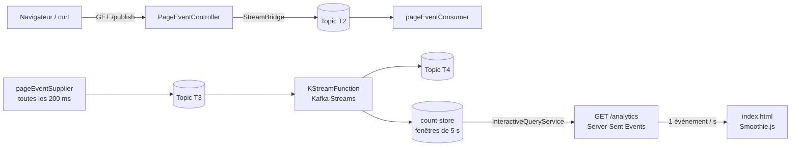
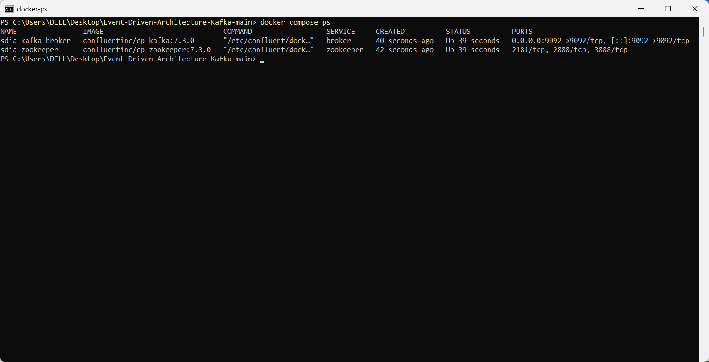
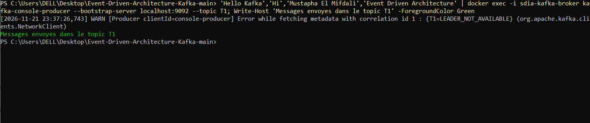
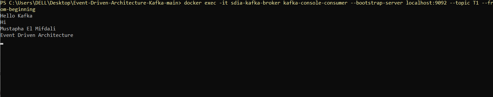
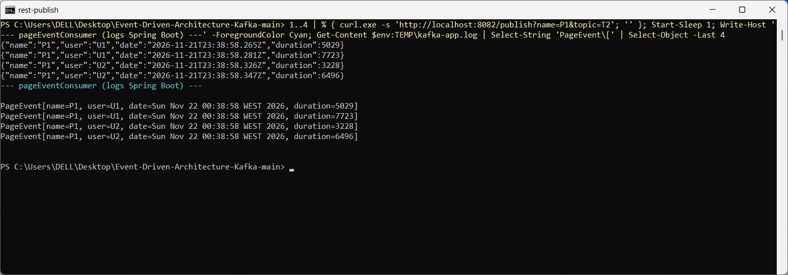
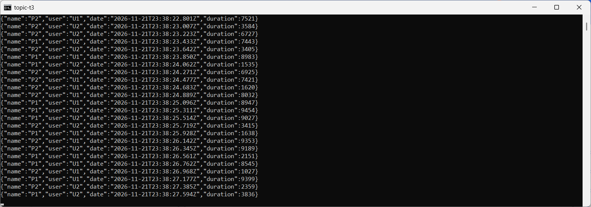
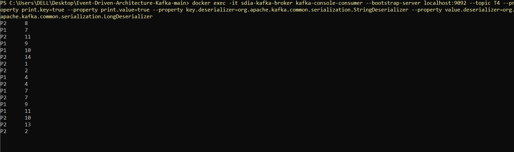
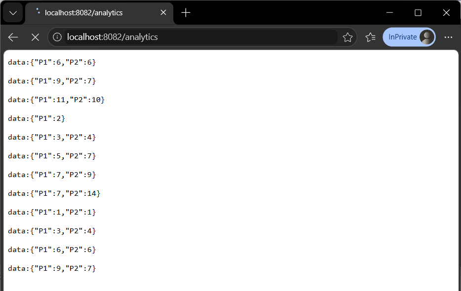
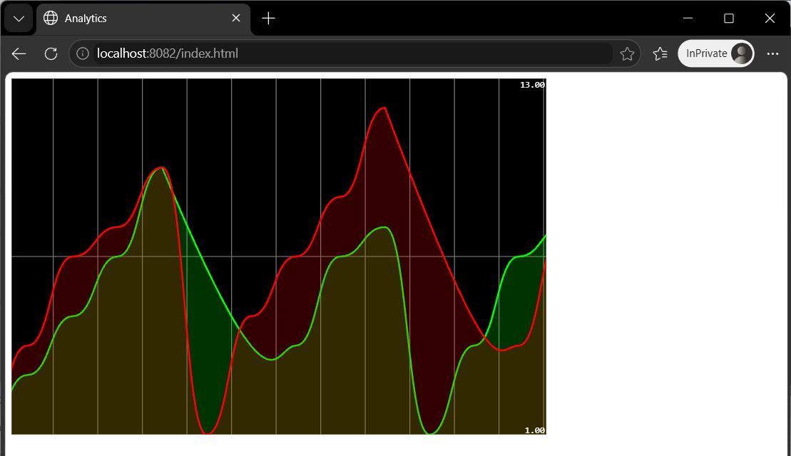

<div align="center">

# Event-Driven Architecture avec Kafka & Spring Cloud Stream

**Activité pratique — Architectures pilotées par les événements**


</div>

| | |
|---|---|
| **Réalisé par** | Mustapha El Mifdali ([@Mustapha-ELMIFDALI](https://github.com/Mustapha-ELMIFDALI)) |
| **Module** | Systèmes distribués — Event-Driven Architecture |
| **Encadrant** | Pr. Mohamed YOUSSFI |
| **Année** | 2026/2027 |

---

## Sommaire

1. [Énoncé](#1-énoncé)
2. [Architecture](#2-architecture)
3. [Technologies](#3-technologies)
4. [Organisation du code](#4-organisation-du-code)
5. [Partie 1 — Kafka avec Docker et outils console](#5-partie-1--kafka-avec-docker-et-outils-console)
6. [Partie 2 — Producer, Consumer et Supplier avec Spring Cloud Stream](#6-partie-2--producer-consumer-et-supplier-avec-spring-cloud-stream)
7. [Partie 3 — Analyse temps réel avec Kafka Streams](#7-partie-3--analyse-temps-réel-avec-kafka-streams)
8. [Partie 4 — Tableau de bord web temps réel](#8-partie-4--tableau-de-bord-web-temps-réel)
9. [Lancer le projet](#9-lancer-le-projet)
10. [Bilan](#10-bilan)

---

## 1. Énoncé

1. Télécharger Kafka, démarrer **Zookeeper** et **Kafka-server**, puis tester avec `kafka-console-producer` et `kafka-console-consumer`.
2. Refaire la même chose avec **Docker** : fichier `docker-compose.yml`, conteneurs `zookeeper` et `kafka-broker`, tests console.
3. Avec **Kafka** et **Spring Cloud Stream**, créer :
   - un service **Producer** Kafka exposé par un **RestController** ;
   - un service **Consumer** Kafka ;
   - un service **Supplier** Kafka ;
   - un service de **Data Analytics temps réel** (stream processing) avec **Kafka Streams** ;
   - une **application web** qui affiche les résultats de l'analyse en temps réel.

Le domaine choisi est celui du cours : des visites de pages web, chacune représentée par un `PageEvent`.

```java
public record PageEvent(String name, String user, Date date, long duration) {}
```

| Champ | Signification | Exemple |
|---|---|---|
| `name` | page visitée | `P1`, `P2` |
| `user` | visiteur | `U1`, `U2` |
| `date` | instant de la visite | `2026-11-21T23:38:22.801Z` |
| `duration` | durée de la visite (ms) | `7521` |

---

## 2. Architecture



| Composant | Entrée | Sortie | Rôle |
|---|---|---|---|
| `PageEventController#publish` | requête HTTP | topic choisi (`T2`) | publie un événement à la demande |
| `pageEventConsumer` | `T2` | console | affiche chaque événement reçu |
| `pageEventSupplier` | — | `T3` | simule un flux continu (un événement / 200 ms) |
| `KStreamFunction` | `T3` | `T4` + `count-store` | compte les visites par page sur des fenêtres de 5 s |
| `PageEventController#analytics` | `count-store` | flux SSE | pousse les compteurs au navigateur chaque seconde |
| `index.html` | flux SSE | graphique | trace une courbe par page |

---

## 3. Technologies

| Rôle | Outil |
|---|---|
| Langage | Java 21 |
| Framework | Spring Boot 4.1, Spring Cloud 2025.1 |
| Messagerie | Apache Kafka (`confluentinc/cp-kafka:7.3.0`) + Zookeeper (`cp-zookeeper:7.3.0`) |
| Intégration | Spring Cloud Stream (modèle fonctionnel, binders Kafka et Kafka Streams) |
| Stream processing | Kafka Streams : filtrage, regroupement, fenêtrage, state store, Interactive Queries |
| Push temps réel | Server-Sent Events avec Reactor (`Flux`) |
| Front | HTML + JavaScript + [Smoothie Charts](http://smoothiecharts.org/) |
| Conteneurs | Docker, Docker Compose |
| Build | Maven (wrapper inclus) |

---

## 4. Organisation du code

```text
Event-Driven-Architecture-Kafka/
├── compose.yml                         # Zookeeper + broker Kafka
├── pom.xml
├── mvnw, mvnw.cmd
├── images/                             # captures d'écran des tests
└── src/
    ├── main/
    │   ├── java/net/elmifdali/kafkaspringcloudstream/
    │   │   ├── KafkaSpringCloudStreamApplication.java
    │   │   ├── events/PageEvent.java
    │   │   ├── controllers/PageEventController.java   # /publish et /analytics
    │   │   └── handlers/PageEventHandler.java         # Consumer, Supplier, Kafka Streams
    │   └── resources/
    │       ├── application.properties                 # bindings et topics
    │       └── static/index.html                      # tableau de bord
    └── test/java/net/elmifdali/kafkaspringcloudstream/
        └── KafkaSpringCloudStreamApplicationTests.java
```

---

## 5. Partie 1 — Kafka avec Docker et outils console

### 5.1 Sans Docker (installation locale)

Après avoir téléchargé et décompressé Kafka :

```bash
# Windows
bin\windows\zookeeper-server-start.bat config\zookeeper.properties
bin\windows\kafka-server-start.bat config\server.properties

# Linux / macOS
bin/zookeeper-server-start.sh config/zookeeper.properties
bin/kafka-server-start.sh config/server.properties
```

### 5.2 Avec Docker Compose

Le fichier [`compose.yml`](compose.yml) lance deux conteneurs : `sdia-zookeeper` (port 2181) et `sdia-kafka-broker` (port 9092 exposé sur la machine).

```bash
docker compose up -d
docker compose ps
```

<p align="center">
  <br>
  <em>Figure 1 — Les deux conteneurs sont démarrés.</em>
</p>

### 5.3 Test avec `kafka-console-producer`

```bash
docker exec -it sdia-kafka-broker kafka-console-producer \
  --bootstrap-server localhost:9092 --topic T1
```

<p align="center">
  <br>
  <em>Figure 2 — Quatre messages envoyés dans <code>T1</code>. L'avertissement <code>LEADER_NOT_AVAILABLE</code> est normal : le topic est créé automatiquement au premier envoi.</em>
</p>

### 5.4 Test avec `kafka-console-consumer`

```bash
docker exec -it sdia-kafka-broker kafka-console-consumer \
  --bootstrap-server localhost:9092 --topic T1 --from-beginning
```

<p align="center">
  <br>
  <em>Figure 3 — Le consumer relit les quatre messages depuis le début du topic.</em>
</p>

---

## 6. Partie 2 — Producer, Consumer et Supplier avec Spring Cloud Stream

L'application tourne sur le port **8082**. Toutes les liaisons fonction ↔ topic sont déclarées dans [`application.properties`](src/main/resources/application.properties) :

```properties
spring.application.name=kafka-spring-cloud-stream
server.port=8082

spring.cloud.function.definition=pageEventConsumer;pageEventSupplier;KStreamFunction

spring.cloud.stream.bindings.pageEventConsumer-in-0.destination=T2

spring.cloud.stream.bindings.pageEventSupplier-out-0.destination=T3
spring.cloud.stream.bindings.pageEventSupplier-out-0.producer.poller.fixed-delay=200

spring.cloud.stream.bindings.KStreamFunction-in-0.destination=T3
spring.cloud.stream.bindings.KStreamFunction-out-0.destination=T4

spring.cloud.stream.kafka.streams.binder.configuration.commit.interval.ms=1000
```

Spring Cloud Stream associe chaque bean à un binding nommé `<bean>-in-0` / `<bean>-out-0`. Le code métier ne dépend pas de Kafka : changer de broker (RabbitMQ par exemple) revient à changer de binder.

### 6.1 Producer via RestController

```java
@GetMapping("/publish")
public PageEvent publish(String name, String topic) {
    PageEvent event = new PageEvent(name,
            Math.random() > 0.5 ? "U1" : "U2",
            new Date(),
            new Random().nextInt(10000));
    streamBridge.send(topic, event);
    return event;
}
```

`StreamBridge` permet d'envoyer un message vers n'importe quelle destination depuis du code impératif.

### 6.2 Consumer

```java
@Bean
public Consumer<PageEvent> pageEventConsumer() {
    return input -> System.out.println(input);
}
```

Le bean s'abonne à `T2` grâce au binding `pageEventConsumer-in-0`.

<p align="center">
  <br>
  <em>Figure 4 — Quatre appels à <code>/publish?name=P1&amp;topic=T2</code> (réponses JSON en haut) et les mêmes événements reçus par <code>pageEventConsumer</code> dans les logs Spring Boot (en bas).</em>
</p>

### 6.3 Supplier

```java
@Bean
public Supplier<PageEvent> pageEventSupplier() {
    return () -> new PageEvent(
            Math.random() > 0.5 ? "P1" : "P2",
            Math.random() > 0.5 ? "U1" : "U2",
            new Date(),
            10 + new Random().nextInt(10000));
}
```

Spring Cloud Stream appelle le Supplier périodiquement (1 s par défaut, ici **200 ms** grâce à `poller.fixed-delay`). Il joue le rôle d'un capteur qui alimente le topic `T3` en continu.

```bash
docker exec -it sdia-kafka-broker kafka-console-consumer \
  --bootstrap-server localhost:9092 --topic T3
```

<p align="center">
  <br>
  <em>Figure 5 — Le flux produit par le Supplier : environ cinq événements par seconde dans <code>T3</code>.</em>
</p>

---

## 7. Partie 3 — Analyse temps réel avec Kafka Streams

```java
@Bean
public Function<KStream<String, PageEvent>, KStream<String, Long>> KStreamFunction() {
    return input -> input
            .filter((k, v) -> v.duration() > 100)
            .map((k, v) -> new KeyValue<>(v.name(), v.duration()))
            .groupByKey(Grouped.with(Serdes.String(), Serdes.Long()))
            .windowedBy(TimeWindows.ofSizeWithNoGrace(Duration.ofSeconds(5)))
            .count(Materialized.as("count-store"))
            .toStream()
            .map((k, v) -> new KeyValue<>(k.key(), v));
}
```

| Étape | Effet |
|---|---|
| `filter` | ignore les visites de 100 ms ou moins |
| `map` | la clé devient le nom de la page |
| `groupByKey` | regroupe les visites par page |
| `windowedBy` | fenêtres fixes (*tumbling*) de 5 secondes |
| `count` | nombre de visites par page et par fenêtre, stocké dans `count-store` |
| `toStream` + `map` | retire la fenêtre de la clé et publie `(page, total)` dans `T4` |

Par défaut, Kafka Streams ne publie ses agrégats qu'au bout de 30 s. La propriété `commit.interval.ms=1000` ramène ce délai à une seconde.

Pour lire `T4`, il faut indiquer au consumer le type de la clé (`String`) et de la valeur (`Long`) :

```bash
docker exec -it sdia-kafka-broker kafka-console-consumer \
  --bootstrap-server localhost:9092 --topic T4 \
  --property print.key=true --property print.value=true \
  --property key.deserializer=org.apache.kafka.common.serialization.StringDeserializer \
  --property value.deserializer=org.apache.kafka.common.serialization.LongDeserializer
```

<p align="center">
  <br>
  <em>Figure 6 — Les compteurs par page publiés dans <code>T4</code>. Ils augmentent dans une fenêtre puis repartent de 1 à la fenêtre suivante.</em>
</p>

---

## 8. Partie 4 — Tableau de bord web temps réel

### 8.1 Endpoint `/analytics`

Le contrôleur interroge le state store `count-store` avec `InteractiveQueryService` et envoie, chaque seconde, le nombre de visites des 5 dernières secondes au format Server-Sent Events.

```java
@GetMapping(value = "/analytics", produces = MediaType.TEXT_EVENT_STREAM_VALUE)
public Flux<Map<String, Long>> analytics() {
    return Flux.interval(Duration.ofSeconds(1)).map(tick -> {
        Map<String, Long> result = new HashMap<>();
        ReadOnlyWindowStore<String, Long> store = interactiveQueryService
                .getQueryableStore("count-store", QueryableStoreTypes.windowStore());
        Instant now = Instant.now();
        try (var it = store.fetchAll(now.minusSeconds(5), now)) {
            it.forEachRemaining(kv -> result.merge(kv.key.key(), kv.value, Long::sum));
        }
        return result;
    });
}
```

<p align="center">
  <br>
  <em>Figure 7 — <code>http://localhost:8082/analytics</code> : un objet JSON <code>{"P1":…,"P2":…}</code> par seconde.</em>
</p>

### 8.2 Page `index.html`

La page ouvre un `EventSource` vers `/analytics`, puis ajoute chaque valeur reçue à une série temporelle Smoothie Charts : une courbe pour `P1`, une pour `P2`.

```javascript
var stockEventSource = new EventSource("/analytics");
stockEventSource.addEventListener("message", function (event) {
    pages.forEach(function (v) {
        val = JSON.parse(event.data)[v];
        courbe[v].append(new Date().getTime(), val);
    });
});
```

<p align="center">
  <br>
  <em>Figure 8 — Nombre de visites de P1 et P2 sur les 5 dernières secondes, mis à jour en direct.</em>
</p>

---

## 9. Lancer le projet

**Prérequis :** JDK 21, Docker Desktop.

```bash
git clone https://github.com/Mustapha-ELMIFDALI/Event-Driven-Architecture-Kafka.git
cd Event-Driven-Architecture-Kafka

docker compose up -d          # Zookeeper + Kafka
./mvnw spring-boot:run        # sous Windows : mvnw.cmd spring-boot:run
```

| URL | Contenu |
|---|---|
| http://localhost:8082/ | tableau de bord temps réel |
| http://localhost:8082/analytics | flux SSE brut |
| http://localhost:8082/publish?name=P1&topic=T2 | publier un événement |

Les premières valeurs arrivent après quelques secondes, le temps que Kafka Streams démarre et remplisse sa première fenêtre.

Pour tout arrêter :

```bash
docker compose down
```

---

## 10. Bilan

Ce TP couvre une chaîne événementielle complète :

- **production** d'événements à la demande (REST) et en continu (Supplier) ;
- **transport** par Kafka ;
- **consommation** par un Consumer Spring ;
- **traitement en flux** avec Kafka Streams (fenêtrage, agrégation, state store) ;
- **restitution** en temps réel dans le navigateur grâce aux Server-Sent Events.

Le modèle fonctionnel de Spring Cloud Stream réduit le code d'infrastructure à quelques beans et quelques lignes de configuration, et garde la logique métier indépendante du broker.

---

<div align="center">

Mustapha El Mifdali · 2026/2027

</div>
